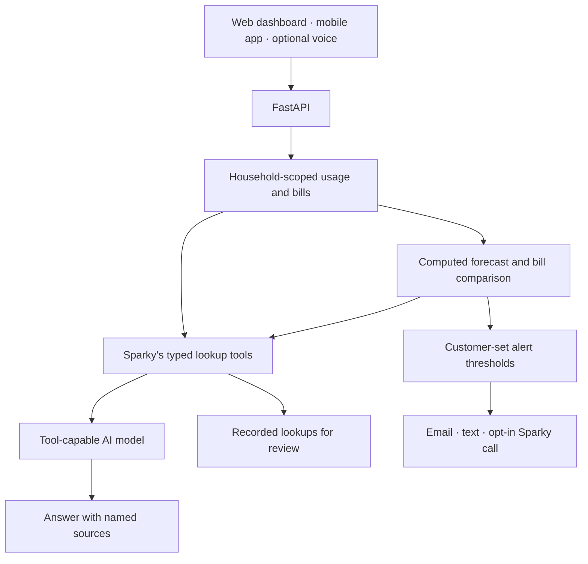

<p align="center">
  
</p>

<h1 align="center">Kea Energy · Home Energy Advisor</h1>

<p align="center">
  See how a home uses energy. Understand the bill. Ask Sparky what changed.
</p>

<p align="center">
  Team HAKAS · Scenario 10 · CS778 S2 2026 AWS Challenge
</p>

<p align="center">
  <a href="#the-experience">See the product</a> ·
  <a href="#meet-sparky">Meet Sparky</a> ·
  <a href="#run-the-demo">Run the demo</a> ·
  <a href="#how-it-works">How it works</a>
</p>

## One home, one clear story

Kea brings a home energy view, usage history, bills, and an AI assistant into a
web portal and mobile prototype. It helps a customer see where power is going,
compare periods and bills, and understand a possible bill shock before the cycle
closes. Sparky can explain the result and bring in a person when the question
needs human care.

> **Prototype boundary:** The included accounts are synthetic. Demo dollar figures
> use illustrative rates; they are not a live Kea Energy tariff. Recorded sources
> make an answer reviewable, but do not guarantee the model interpreted them
> correctly. Real customer use still needs production identity and household
> authorization.

## The experience

<p align="center">
  
</p>

<p align="center"><sub>The Kea Home scene uses green for solar, blue for battery supply, and amber for grid import.</sub></p>


The **web dashboard** uses the energy-flow component from
[Kea Energy Home](https://github.com/nair-akash/kea-energy-home): the same
house illustration, conduit paths, GSAP motion, and source colours. The mobile
scene follows the same paths and colours. Weather is modelled live when
available; displayed kW and device flows are an **illustrative simulation**, not
readings from a connected meter, inverter, battery, or EV.

| Experience | Web | Mobile |
| --- | --- | --- |
| **Home energy** | Animated Kea Home beside household usage, projected cost, and bill-risk status. | Kea Home preview with solar-green, battery-blue, and grid-amber flows. |
| **Usage comparison** | Daily, weekly, and monthly views with a previous-period comparison. | Select two dates, weeks, or months; inspect usage or cost side by side. |
| **Bills** | A labelled demo billing preview; Sparky compares backend bill facts when a prior bill exists. | Account invoice details, a current-versus-prior total when both exist, and a shareable invoice view. |
| **Bill-shock alerts** | A visible forecast and reason; set email, text, and optional call thresholds. | Forecast and the same alert preferences in Settings. |
| **Sparky AI** | Chat, named sources, bill upload, and voice when the server reports voice ready. | Chat and a dedicated status card showing the active model and whether it is ready. |
| **Connected home** | Device discovery and energy-breakdown context. | A network scan that separates discovery from actual power readings. |

### Meet Sparky

<p align="center"></p>

Sparky can look up the signed-in demo household's usage, bills, forecast,
comparisons, and support options through typed tools. Answers surface named
sources, and the tool calls are recorded for review when persistence is on.
For a large predicted bill difference, customers can opt in to an automated
**Sparky call** with their own threshold and quiet hours. Email and text have
separate thresholds; actual delivery depends on the configured gateways.

The server can use a local Ollama model when a **tool-capable** model is
installed and selected. Mobile Settings shows the active model and a refreshable
readiness result. The offline phone-model switch currently **records interest
only**: this build has no on-device model download or offline answering runtime.
See [mobile setup](services/mobile/README.md) and the
[provider configuration](services/api/README.md) before demonstrating AI live.

## Run the demo

**Prerequisites:** Python, Node.js/npm, Docker with Compose, and the service
dependencies described in the [backend](services/api/README.md) and
[frontend](services/web/README.md) guides.

```bash
git clone git@github.com:CS778-S2-2026-AWS-Challenge/HAKAS-kea-energy.git
cd HAKAS-kea-energy
cp .env.example .env
make setup
make db
make api-migrate
make api-seed
```

Start the API and web app in **separate terminals**. Demo sign-in is enabled
only for local synthetic accounts:

```bash
KEA_DEMO_LOGINS=1 make api-dev   # http://localhost:8000/docs
make web-dev   # http://localhost:5173
```

Open <http://localhost:5173> and sign in with the synthetic July account
(`july@kea.example` / `julyhouse24`). Sparky requires a configured model that
supports tool calls; check `model_ready` at
<http://localhost:8000/api/health> before asking a question. For a local
provider, set `KEA_PROVIDER=ollama`, run `ollama pull qwen3:4b`, and use the
tool-capable default `qwen3:4b` (or set `KEA_OLLAMA_MODEL` explicitly). A
running Ollama server alone does
not count as ready. `make help` lists the other commands; `make check` runs the
root API, web, and attribution checks.

For the iOS/Android client, use the [mobile setup guide](services/mobile/README.md).

## How it works



Python computes the figures and exposes household-scoped facts through tools.
The model selects tools and writes the reply; it does not get to invent a
meter reading. The recorder keeps tool arguments and results for review. Read
[ADR-0011](docs/adr/0011-agentic-tool-use.md) for the design, and
[SECURITY.md](SECURITY.md) for the synthetic-data boundary and release gates.

## Find your way around

| Path | Purpose |
| --- | --- |
| [`services/api/`](services/api/) | FastAPI backend, analytics, agent, and persistence. |
| [`services/web/`](services/web/) | React customer portal. |
| [`services/mobile/`](services/mobile/) | React Native and Expo client. |
| [`ml/`](ml/) | Model evaluation, prompts, and benchmarks. |
| [`data/`](data/) | Data pipeline, sample data, and dictionary. |
| [`infra/`](infra/) | Local services and AWS deployment material. |
| [`contracts/`](contracts/) | Committed OpenAPI contract shared by clients and API. |

New contributors: start with [your team's page](docs/teams/README.md), then
read [CONTRIBUTING.md](CONTRIBUTING.md). For deeper context, see the
[architecture decisions](docs/adr/) and [API contract](contracts/openapi.json).
