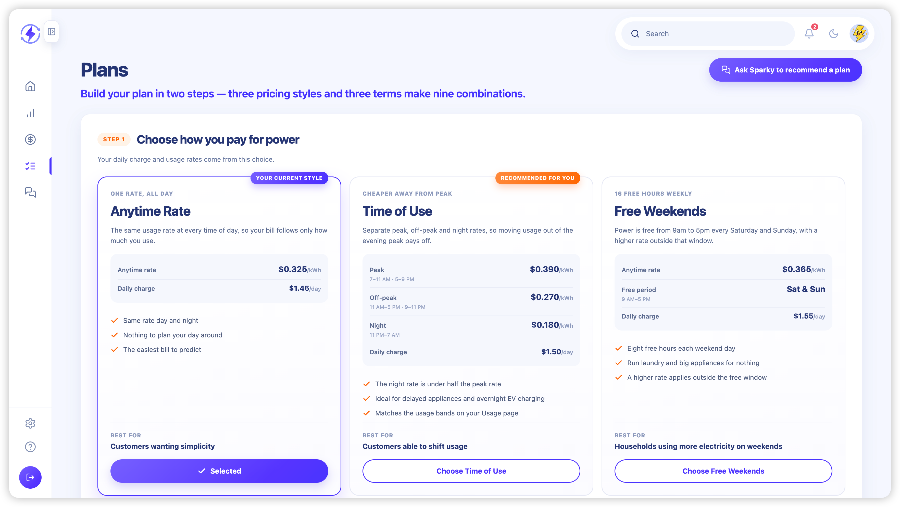
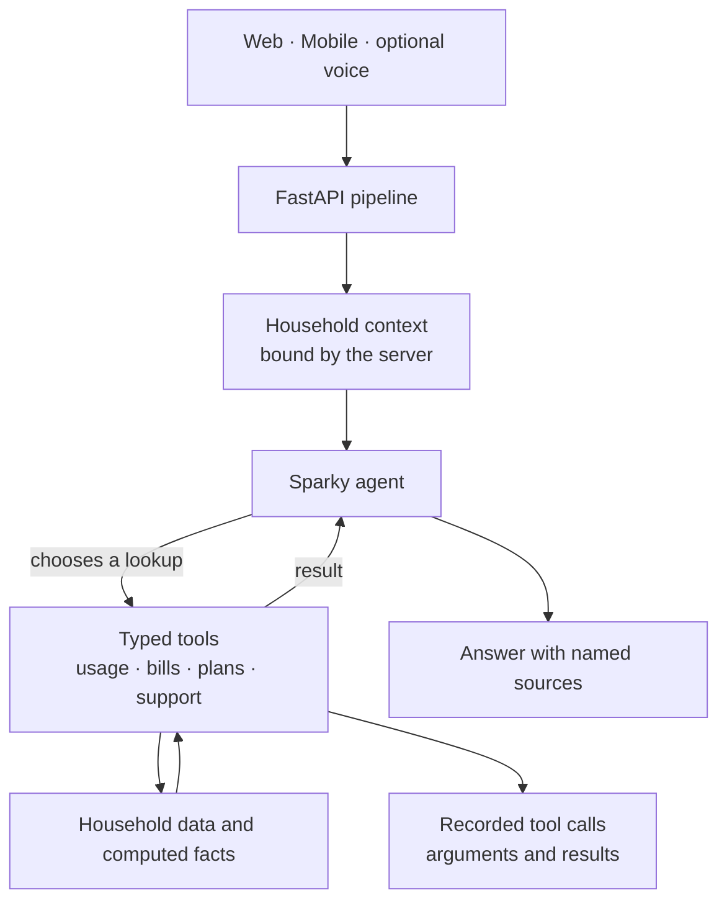

<p align="center">
  
</p>

<h1 align="center">Kea Energy · Home Energy Advisor</h1>

<p align="center">
  Understand electricity use, explain bill changes, and ask Sparky for answers grounded in household data.
</p>

<p align="center">
  Team HAKAS · Scenario 10 · CS778 S2 2026 AWS Challenge
</p>

<p align="center">
  <a href="#see-the-product">See the product</a> ·
  <a href="#run-the-demo">Run the demo</a> ·
  <a href="#how-it-works">How it works</a> ·
  <a href="#find-your-way-around">Explore the repo</a>
</p>

## What this project does

Kea is a customer portal and mobile prototype for understanding power use and
preventing bill shock. Customers can inspect usage and bills, compare plans, and
ask Sparky why a cost changed. The assistant can retrieve household-scoped facts
through typed tools and records the lookups behind its answer.

> **Prototype boundary:** The included accounts are synthetic. Demo dollar figures
> use illustrative rates; they are not a live Kea Energy tariff. Recorded sources
> make an answer reviewable, but do not guarantee the model interpreted them
> correctly. Real customer use still needs production identity and household
> authorization.

## See the product



*Plans view from the demo. The pictured prices and recommendation are
illustrative.*

| Explore | What you can see |
| --- | --- |
| **Usage and bills** | Household usage, estimated costs, and bill-change explanations. |
| **Sparky** | Questions answered through household-scoped lookups, with named sources. |
| **Plans and support** | Plan information and a route to human help when the data cannot answer. |
| **Mobile** | An Expo app with usage, billing, plans, and an illustrative Kea Home scene. |

The Kea Home scene visualizes a possible home energy system. Its energy flows
are examples, not measurements from a customer's solar panels, battery, or EV.
See the [mobile guide](services/mobile/README.md) for current integration limits.

## Run the demo

**Prerequisites:** Python, Node.js/npm, Docker with Compose, and the service
dependencies described in the [backend](services/api/README.md) and
[frontend](services/web/README.md) guides.

```bash
git clone git@github.com:CS778-S2-2026-AWS-Challenge/HAKAS-kea-energy.git
cd HAKAS-kea-energy
cp .env.example .env
make setup
make db
make api-migrate
make api-seed
```

Start the API and web app in **separate terminals**. Demo sign-in is enabled
only for local synthetic accounts:

```bash
KEA_DEMO_LOGINS=1 make api-dev   # http://localhost:8000/docs
make web-dev   # http://localhost:5173
```

Open <http://localhost:5173> and sign in with the synthetic July account
(`july@kea.example` / `julyhouse24`). Sparky requires a configured model that
supports tool calls; check <http://localhost:8000/api/health> for provider
readiness. `make help` lists the other commands; `make check` runs the root
API, web, and attribution checks.

For the iOS/Android client, use the [mobile setup guide](services/mobile/README.md).

## How it works



Python scopes retrieval to the requested household and computes facts such as
bill projections. The model chooses which tools to call and writes the reply;
the tool-call recorder keeps the arguments and results for later review. The
offline path uses precomputed fact bundles because it cannot call tools. Read
[ADR-0011](docs/adr/0011-agentic-tool-use.md) for the design and its tradeoffs.

## Find your way around

| Path | Purpose |
| --- | --- |
| [`services/api/`](services/api/) | FastAPI backend, analytics, agent, and persistence. |
| [`services/web/`](services/web/) | React customer portal. |
| [`services/mobile/`](services/mobile/) | React Native and Expo client. |
| [`ml/`](ml/) | Model evaluation, prompts, and benchmarks. |
| [`data/`](data/) | Data pipeline, sample data, and dictionary. |
| [`infra/`](infra/) | Local services and AWS deployment material. |
| [`contracts/`](contracts/) | Committed OpenAPI contract shared by clients and API. |

New contributors: start with [your team's page](docs/teams/README.md), then
read [CONTRIBUTING.md](CONTRIBUTING.md). For deeper context, see the
[architecture decisions](docs/adr/), [API contract](contracts/openapi.json),
and [security guidance](SECURITY.md).
