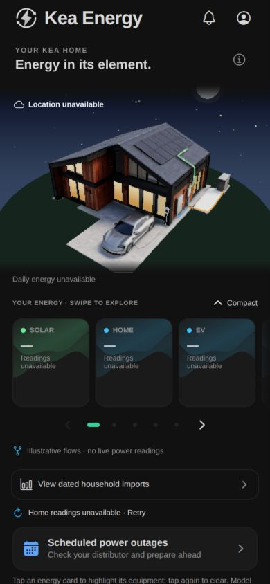
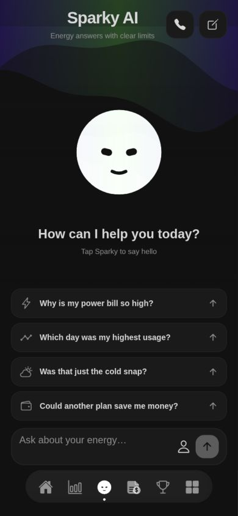
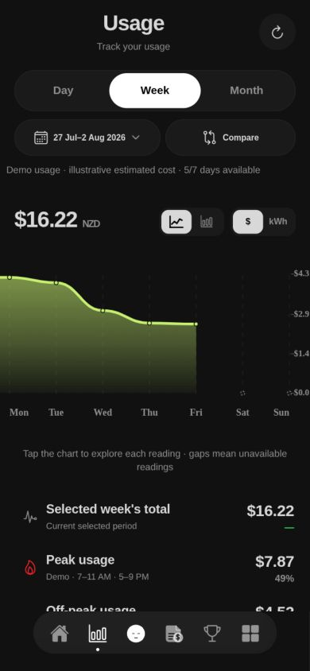
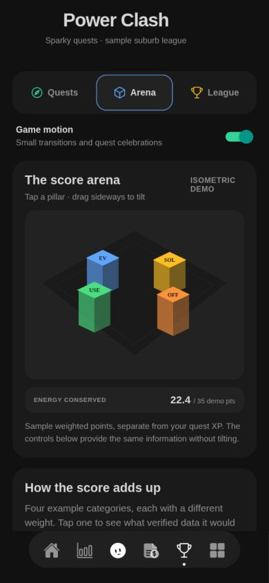
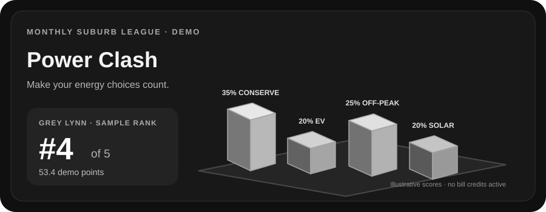
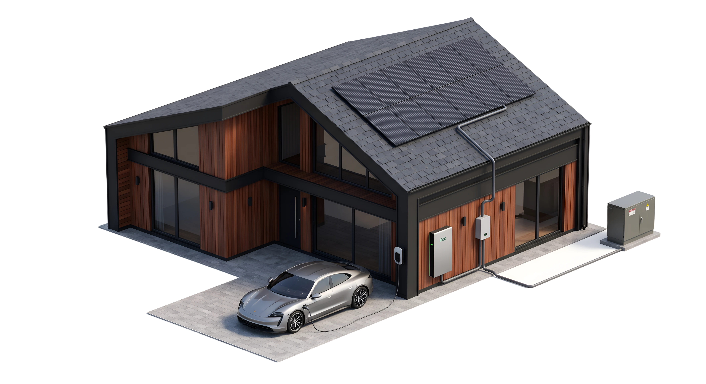
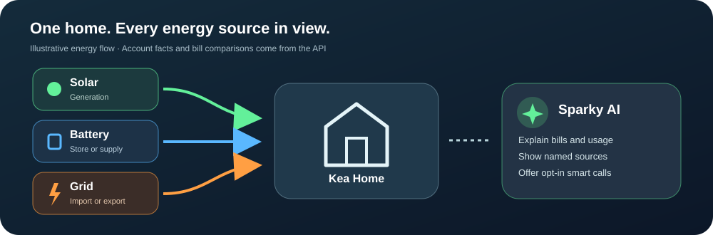
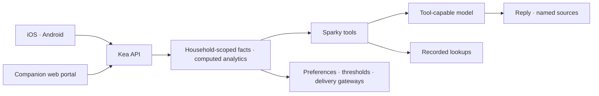

<p align="center">
  
</p>

<h1 align="center">Your home. Your energy. A clearer picture.</h1>

<p align="center">
  <strong>Kea Energy</strong> brings your home, usage and bills together.<br>
  Meet Sparky, your energy companion. Find your next useful step.
</p>

<p align="center">
  <strong>iOS &amp; Android</strong> &nbsp; · &nbsp; React Native + Expo &nbsp; · &nbsp; Companion web portal
</p>

<p align="center">
  <a href="#inside-the-mobile-app">Explore the app</a> &nbsp; / &nbsp;
  <a href="#meet-sparky">Meet Sparky</a> &nbsp; / &nbsp;
  <a href="#try-it-on-your-phone">Try it on your phone</a> &nbsp; / &nbsp;
  <a href="#for-builders">For builders</a>
</p>

---

## Energy, made easier to understand

Open Kea to an interactive 3D home. Explore your energy history, understand a
change in your bill, and ask Sparky a question in your own words. Six mobile
destinations—**Home, Usage, Sparky AI, Billing, Power Clash and More**—connect
the experience around one household's story.

Built by **Team HAKAS** for **Scenario 10 · CS778 S2 2026 AWS Challenge**.
The repository contains the working mobile experience, companion website,
shared API and data platform. Included demo households are synthetic;
production rollout and physical-device acceptance are tracked separately.

## Inside the mobile app

<table>
  <tr>
    <td align="center"><strong>Your 3D energy home</strong><br></td>
    <td align="center"><strong>Meet Sparky · Bloub</strong><br></td>
  </tr>
  <tr>
    <td align="center"><strong>Understand your usage</strong><br></td>
    <td align="center"><strong>Explore Power Clash</strong><br></td>
  </tr>
</table>

Actual captures of the **Expo mobile web build at 390 × 844**, using a synthetic
demo household. Home shows the app's **illustrative flow preview**, with live
readings and location unavailable in this capture. Usage costs and Arena points
are labelled demo values. These are interface previews; native iOS/Android
acceptance is tracked separately. [Capture details](docs/assets/mobile/README.md).

| A place for… | What you can do |
| --- | --- |
| **Your home** | Rotate the 3D house, explore solar, battery, grid and EV paths, and see regional weather shape the scene. Open the Explore Kea dock to find the next screen. |
| **Your usage** | Compare days, weeks or months in energy or cost. Inspect dated hourly and tariff-band views where the API supplies them; missing readings remain gaps and demo intervals are labelled. |
| **Your bills** | Read available invoice details, compare current and previous totals when both exist, and share the invoice view. Inspect the forecast and its basis in Bill Prediction. |
| **Your questions** | Ask Sparky about a bill, a cold snap, a peak day, a plan or an outage. Answers draw on account-scoped tools and surface sources. |
| **Your next step** | Explore Power Clash's Quests, Arena and League; choose a mission and take its context into Sparky. Sample ranks and demo scores remain separate from verified activity. |
| **Your preferences** | Find plans, profile, model readiness, alert preferences and connected-home discovery under More. Set separate email, text and optional call thresholds. |

### A home that feels alive

The new Home experience combines an orbitable 3D model, a holographic opening
reveal, textured materials and regional day/night weather. Solar green, battery
blue, grid amber and EV cyan make the paths easy to follow. Source selection
connects the reading to the scene; gesture ownership separates orbiting from
page scrolling. Reduced Motion respects the device preference.

Weather is **regional modelled Open-Meteo data**, with retry and last-known
labels when appropriate. Energy animation is illustrative unless a fresh,
mapped sensor reading is available. Device discovery and daily meter totals
cannot establish live charging or battery status.

Read the [Home release notes](docs/mobile-immersive-release.md),
[weather and energy behavior](docs/home-weather-flow.md) and
[tablet memory repair](docs/mobile-home-memory.md) for implementation details
and device acceptance boundaries.

### Meet Sparky

<p align="center">
  
</p>

Sparky's mobile face is **Bloub**: an expressive, animated companion with its
own eyes, body motion and Kea mouth treatment. Tap it to say hello; its presence
responds as you interact. See the [Bloub integration and attribution](services/mobile/src/vendor/bloub/README.md).

**Ask a real question. Get an answer grounded in the available evidence.**

- **“Why is my power bill so high?”** Compare bills, dates, usage, weather and the unexplained remainder.
- **“What did I use last week?”** Read dated history, retaining missing days and source labels.
- **“Could another plan save me money?”** Compare usage with the available plan catalogue and its terms.
- **“I can't afford this.”** Record the concern and direct the customer to verified Customer Care contact details.

Python computes the figures; Sparky chooses typed tools and writes the reply.
Named sources and recorded tool calls make answers reviewable. They do not
guarantee every model interpretation is correct. Deterministic hardship policy
sets the handling tier; the model can escalate but cannot lower it. Recording
a concern does not mean a staff member has received the chat.

The mobile app shows provider readiness and streams answers from the Kea API.
Voice depends on the server reporting it ready. Optional on-phone inference is
a separate **native development-build** path for general guidance; bill and
household questions still use the API. **Expo Go cannot run that native model.**
Physical iOS/Android inference remains under validation.

Explore the [account question inventory](docs/sparky-account-coverage.md),
[Android phone test guide](qa/android-phone.md) and
[provider configuration](services/api/README.md).

### Power Clash

**Choose a mission. Explore its impact. Bring the question back to your home.**

Quests, Arena and League organise the mobile challenge. The Arena responds to
touch and offers accessible score controls; contextual Sparky help connects a
mission to Usage, the household's plan and available evidence.

Four categories cover energy conserved against the home's baseline, EV charging
emissions avoided, off-peak money saved and solar emissions avoided. The sample
leaderboard is synthetic. Demo points are not earned rewards; proposed top-three
bill credits are not active. Real rankings require verified data, fair
eligibility, consent and funded retailer settlement.

See [the Power Clash blueprint](docs/design/suburb-power-clash.md),
[engagement design](docs/power-clash-engagement.md) and
[navigation and Arena interaction](docs/power-clash-interaction.md).

<details>
<summary>View the Power Clash concept illustration</summary>



</details>

<a name="start-here"></a>

## Try it on your phone

Use **Expo Go** for the mobile demo. Keep the phone and computer on the same
trusted Wi-Fi. Install prerequisites from the [API guide](services/api/README.md)
and [mobile guide](services/mobile/README.md): Python, Node.js/npm and the service
dependencies. Docker Compose is needed for the optional database-backed path.

### 1 · Get the project

```bash
git clone git@github.com:CS778-S2-2026-AWS-Challenge/HAKAS-kea-energy.git
cd HAKAS-kea-energy
cp .env.example .env
make setup
make mobile-install
```

`make setup` installs API and web dependencies; `make mobile-install` installs
the mobile dependencies. Vault checkouts use the cache-backed instructions in
[STARTUP.md](STARTUP.md) instead.

### 2 · Start the API

In its own terminal, from the repository root:

```bash
cd services/api
KEA_DEMO_LOGINS=1 KEA_PERSIST=0 \
  .venv/bin/uvicorn app.main:app --host 0.0.0.0 --port 8000
```

This exposes the fixture API on your trusted LAN. Documentation is at
<http://localhost:8000/docs>; check <http://localhost:8000/api/health> for its
data source and `model_ready` before demonstrating live AI.

### 3 · Open the mobile app

In a second terminal, from the repository root, enter the computer's Wi-Fi IP:

```bash
cd services/mobile
read -r -p "Computer Wi-Fi IP address: " kea_lan_ip
test -n "$kea_lan_ip" || exit 1
EXPO_PUBLIC_API_URL="http://${kea_lan_ip}:8000" \
  EXPO_PUBLIC_USE_REAL_DATA=true npm run start -- --go --lan
```

Scan Expo's QR code. Sign in with the synthetic July household:
**`july@kea.example` / `julyhouse24`**. `USE_REAL_DATA=true` selects API reads;
the API's fixture mode still supplies synthetic data. `EXPO_PUBLIC_` values
are bundled into the client and must never contain private keys.

Sparky needs a configured **tool-capable** provider. For local Ollama, set
`KEA_PROVIDER=ollama`, run `ollama pull qwen3:4b`, and select `qwen3:4b` or set
`KEA_OLLAMA_MODEL` explicitly. A running Ollama server alone does not count as
ready. See the [API guide](services/api/README.md) for full provider setup.

<details>
<summary>Database-backed accounts and the companion web portal</summary>

From the repository root, initialise the local database:

```bash
make db
make api-migrate
make api-seed
```

Use `KEA_PERSIST=1` instead of `0` in the API command above. Stop the fixture API
before starting another API on port 8000. Only loaded households have data;
additional platform fixtures need the documented data-loading path. The local
web/API development shortcuts run in separate terminals:

```bash
KEA_DEMO_LOGINS=1 KEA_PERSIST=1 make api-dev   # http://localhost:8000/docs
make web-dev   # http://localhost:5173
```

Open <http://localhost:5173>. The website shares the API, with usage, Sparky,
bill upload and browser-local general guidance on supported WebGPU browsers.
Bill extraction needs checking against the original. The web Billing preview
remains labelled demo content. See the [frontend guide](services/web/README.md)
and [browser-local inference limits](docs/design/on-browser-sparky.md).

The original web Home illustration comes from
[Kea Energy Home](https://github.com/nair-akash/kea-energy-home). Below is
**concept artwork**, not a screenshot of the current mobile 3D scene.

<p align="center">
  
</p>



The original source palette and GSAP conduit motion connect the web and mobile
designs; their rendering implementations differ. Source colours identify paths,
not evidence of connected meter, inverter, battery or EV telemetry.

</details>

## For builders



| Start here | What's inside |
| --- | --- |
| [`services/mobile/`](services/mobile/) | React Native, Expo Router, Home, Usage, Sparky and Power Clash. |
| [`services/api/`](services/api/) | FastAPI, analytics, hardship policy, tools and persistence. |
| [`services/web/`](services/web/) | Companion React customer portal. |
| [`contracts/`](contracts/) | Committed OpenAPI interface shared by both clients and the API. |
| [`data/`](data/) | Pipeline, synthetic fixtures, evaluation, sample data and dictionary. |
| [`ml/`](ml/) | Prompts, model evaluation and benchmarks. |
| [`infra/`](infra/) | Local services and AWS deployment material. |
| [`qa/`](qa/) | End-to-end functional tests (Playwright), mobile acceptance testing and device runbooks. |

`make help` lists the root commands. `make check` runs root API, web and
attribution checks; `make mobile-check` runs the separate mobile checks. Native
bundle exports establish build compatibility, not physical device execution.

### Evidence you can inspect

Synthetic accounts, illustrative or estimated figures and missing readings
stay distinguishable. Demo dollar values are not a live Kea Energy tariff;
account catalogue prices and what-if assumptions carry their own source/basis.
Real customer use requires configured, verified identity and household access.
Device energy needs authorized mapped sensors; discovery supplies names only.
Email, text and opt-in Sparky calls depend on configured gateways, thresholds
and quiet hours. A recorded action is not proof of completed delivery.

Start with [CONTRIBUTING.md](CONTRIBUTING.md) and
[your team's page](docs/teams/README.md). Read
[ADR-0011](docs/adr/0011-agentic-tool-use.md), the
[architecture decisions](docs/adr/), the
[API contract](contracts/openapi.json) and [SECURITY.md](SECURITY.md) for the
implementation and release gates.
