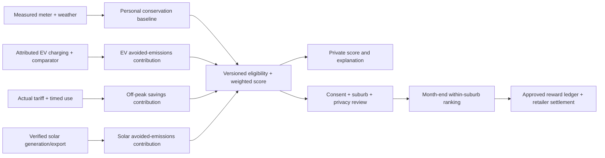

# Suburb Power Clash — implementation blueprint

**Status:** proposed production design, revised 28 September 2026. An interactive **synthetic-data mobile preview** is being built separately. Real household competition, avoided-emissions claims, bill credits, and individual leaderboards remain disabled until the release gates below are met.

## What a player sees

An opted-in person competes **within their verified suburb** for a monthly rank. The score combines four separately evidenced contributions: energy conserved against their own baseline, avoided emissions associated with eligible EV charging, money saved through eligible off-peak use, and avoided emissions associated with verified solar generation. A top-three finish in each suburb is intended to earn an electricity-bill credit after month-end settlement. Credit amounts and programme terms are undecided. The opening screen shows the personal score breakdown, rank, consented suburb leaderboard, bill-credit status, and Sparky's grounded explanation. The interface distinguishes **demo**, **provisional**, **verified**, and **unavailable** figures.

Conservation compares a household with its **own** weather-adjusted history; peer benchmarks cannot substitute for that baseline. Off-peak money saved must use the household's actual tariff. EV and solar contributions need attributable generation or charger observations and a defensible avoided-emissions counterfactual. No category may double count the same kWh. Fairness for people without an EV or solar installation is an unresolved release decision, not something to hide with a default zero.



### Reality checks before implementation

| Brief claim | Verified boundary and resulting product rule |
|---|---|
| Neighbour comparisons consistently save 2–4% | Published Opower experiments found roughly 1.4–2.8% at early sites; Kea has no measured effect yet. Treat behaviour change as a hypothesis and test it with an opt-in holdout, not a promised result. [NBER](https://www.nber.org/papers/w18492) |
| A low user will inevitably rebound unless given streaks and money | The original experiment found a boomerang effect and that approving feedback mitigated it. It does not validate these particular rewards. Give low users positive feedback without encouraging additional use. [Schultz et al.](https://doi.org/10.1111/j.1467-9280.2007.01917.x) |
| NZ is 80–85% renewable; peak savings routinely avoid coal at 650 g/kWh | MBIE reports 88.5% renewable generation for 2025. Marginal generation varies; no fixed peak window or 650/50 g pair is justified. No UI claim that a saved kWh avoided a specified amount of carbon until a reviewed marginal-emissions method exists. [MBIE](https://www.mbie.govt.nz/building-and-energy/energy-and-natural-resources/energy-statistics-and-modelling/energy-publications-and-technical-papers/energy-in-new-zealand/energy-in-new-zealand-2026/renewables), [Electricity Authority](https://www.ea.govt.nz/news/eye-on-electricity/marginal-generators-and-prices-in-the-electricity-market/) |
| Transpower intensity can calculate avoided emissions | Transpower EM6 reports average grid-mix intensity, useful as labelled context; it is not by itself a marginal avoided-emissions factor. Do not call savings an “offset”. [Transpower](https://www.transpower.co.nz/news/new-transpower-tool-unlocks-electricity-emissions-tracking-all) |
| A pseudonym makes within-suburb rankings safe | Even month-end ranks and repeat pseudonyms may identify a household in a small suburb. Require explicit disclosure consent, minimum cohort, access control, suppression, and a Privacy Impact Assessment (PIA). [Privacy Commissioner: disclosure](https://www.privacy.org.nz/privacy-principles/11/), [PIA guidance](https://www.privacy.org.nz/responsibilities/privacy-impact-assessments/) |
| Top-three bill credits can be shown as an active offer | The proposed credits are **not** funded or approved. Keep every credit amount `null` and show no payout countdown until sponsor, retailer, legal, tax, terms, fulfilment, and relevant sales-promotion review are complete. [DIA guidance](https://www.dia.govt.nz/Gambling-Fact-Sheet-9---Sales-Promotions) |

## Release gates and ownership

| Gate | Acceptance evidence | Owner before real-data release |
|---|---|---|
| Identity and household authority | Replace synthetic demo login in `services/api/app/auth.py` with production auth, expiring sessions, server-side household binding and authorization tests. Never accept a client-selected household ID for `/me`. | API/security |
| Meter provenance | Every rewarded half-hour has a dated, measured import reading, source, completeness flag, and meter ownership. Reject estimates, generated demo profiles, missing intervals, and unverified solar/export or EV adjustments. | Data |
| Geography and consent | Approved suburb assignment separate from public responses; explicit opt-in to a **within-suburb individual** leaderboard, withdrawal, erasure/retention rules, minimum cohort, member access controls, and PIA. Current `Customer.region` is too broad and has no verified suburb. | Privacy/product |
| Fairness and safety | Independent review of weather baseline, cold-weather hardship, households without EV/solar, property ownership, score manipulation, and appeals. Low usage is a review signal, never evidence of a holiday. | Product/data |
| EV, solar, tariff, and carbon | Charger ownership and eligible sessions, defensible EV travel comparator, measured solar generation/export, actual tariff/time windows, licensed time-stamped marginal factors, and explicit rules preventing double counting. Missing evidence makes that category unavailable, not zero. | Energy/data |
| Rewards | Written funding, top-three eligibility, tie rule, retailer bill settlement, legal terms, tax and financial audit. Reward ledger reconciles exactly; no client calculation determines money. | Business/legal |
| Device performance | 60 fps target measured on representative iOS and Android devices, including a low-end device, with reduced-motion and static-list fallback. No performance claim based on simulator or export alone. | Mobile/QA |

## Scoring contract

The mobile preview uses **illustrative** weights of 35% conservation, 20% EV, 25% off-peak savings, and 20% solar. It caps each category for a bounded 100-point example. These weights and caps are **not approved production rules**. Before a real score exists, agree on participation eligibility, treatment of homes without EV/solar, minimum verified coverage per category, normalization, double-count prevention, and an appeal path. Freeze the approved algorithm/version with each monthly snapshot; never silently recalculate published results.

1. **Input:** a half-hourly import interval `E(h,t)` in kWh, source `measured`, timezone-aware timestamp, account/meter ownership, local `Pacific/Auckland` date, and `expected_intervals` for that local day (46/48/50 across daylight-saving changes). Deduplicate by meter and interval. No data from the contest month may train its baseline.
2. **Freeze baseline at month start:** from the preceding 21 complete local days, take the median for each local wall-clock half-hour slot separately for weekdays and weekends. Require at least 12 weekday and 4 weekend observed examples for every normal slot. On a fall-back day, both occurrences of a repeated clock slot use that slot's frozen median; distinguish their readings by UTC offset. On a spring-forward day, skipped slots contribute neither baseline nor reading. Use the recorded `expected_intervals` to check the actual day; do not duplicate or invent readings. A household without enough history is `unqualified`; it never receives a guessed score.
3. **Weather:** using at least 56 prior complete days from the same location and weather source, fit a reviewed, nonnegative daily temperature response `f(T) = max(0.1, α + βh·max(15−T,0) + βc·max(T−22,0))` with `βh, βc ≥ 0`. Record model version and fit diagnostics. For contest day `d`, `B(h,t) = max(0, median_slot(h,t) × clamp(f(Td)/f(Tref), 0.75, 1.25))`, where `Tref` is the median temperature of the baseline days with that day type. A weather observation can settle a provisional score after the day closes, but the fitted coefficients and slot medians remain frozen. A failed fit or missing temperature makes the score unavailable, not zero.
4. **Quality:** a day qualifies for prize ranking only when every expected interval has a measured, nonnegative value and no disputed meter changes. An incomplete day can show a personal progress preview labelled `provisional`, but contributes nothing to the ranked month. Solar/export households require separately verified import, export, and on-site generation treatment; until then they remain preview-only. Safety review also covers heating hardship before any incentive to consume less.
5. **Four separately auditable contributions:** `D(t) = B(t) − E(t)` and `energy_reduction_pct = 100 × ΣD(t)/ΣB(t)` over qualified intervals; include negative `D` in the displayed result. EV avoided emissions require eligible charger intervals and an approved comparison with a displaced transport mode, net of charge electricity. Off-peak savings require a counterfactual schedule priced with the **same actual tariff**, including time-varying rates; never equate lower kWh with a lower bill. Solar avoided emissions require separately measured generation, self-consumption/export treatment, and an approved *marginal* counterfactual. Assign each kWh to at most one credited category to prevent double counting. A missing input is `unavailable`, not zero.
6. **Score and rank:** the preview uses `min(max(value / cap, 0), 1) × weight` for each sample category (conservation: 25% reduction cap/35 points; EV: 50 kg CO₂e/20; off-peak: NZ$40/25; solar: 50 kg CO₂e/20). Those caps exist only to demonstrate a weighted breakdown. A real formula needs the fairness and eligibility decisions above, documented units, versioned source data, uncertainty bounds, and Decimal arithmetic. Sort qualified players **inside one verified suburb** by unrounded settled score, with an approved tie rule and no client-selected household/suburb ID. No real individual rank or top-three reward appears before consent/privacy and scoring gates pass.
7. **Monthly settlement:** aggregate only qualified days; require at least 80% of the month's expected intervals and at least 14 eligible local days, with no unresolved anomaly. The status stays `provisional` until data quality, consent, scoring and appeals close. The 0.15 kWh/day threshold is a configurable **anomaly flag** for review; it never infers occupancy or automatically declares a vacation. A funded, approved credit can be issued only after an auditable month-end top-three settlement and retailer reconciliation.

All score inputs, revisions, consent, and decisions need an audit record. Use decimal arithmetic for energy and money, UTC in storage plus the NZ local date in settlement logic. A negative score stays negative; never turn increased usage into a positive badge. Show a source and quality label beside each figure.

## Mobile screen and interaction contract

The proposed route is `services/mobile/src/app/(tabs)/clash.tsx`, registered in `(tabs)/_layout.tsx`. The synthetic preview can be visible as **DEMO**; switching to real data must use a separate server-controlled flag after the release gates. Use the charcoal and grey theme from `src/theme/index.tsx`. Avoid a green territory-map treatment; this game is about people in one suburb, not suburbs against one another.

| Component | Inputs and behaviour | Empty / error / accessibility |
|---|---|---|
| `SuburbLeagueHeader` | Current NZ month, own suburb, personal rank and score status. | Demo/unavailable/provisional labels; no colour-only rank or unapproved payout countdown. |
| `ScoreBreakdown` | Conservation, EV, off-peak and solar values, each category's weight, points, evidence/quality and method. | Explain unavailable or ineligible categories; do not imply all households have EV or solar. Reduced motion keeps detail transitions static. |
| `SuburbLeaderboard` | Month-end **individual** ranks within the same verified suburb, using consented pseudonyms and server-settled ties. | Hide until production auth, explicit disclosure consent and PIA approve cohort threshold, member access and suppression; no raw traces, addresses or live presence. |
| `MonthlyRewardCard` | Top-three bill-credit rules and settlement status from an approved server ledger. | Concept-only until terms/funding/retailer settlement exist; never show a made-up dollar amount or earned credit. |
| `SparkyCompanionWidget` | One short explanation grounded in the person's own verified category evidence. | No appliance diagnosis, unsupported carbon claim, shame or household comparison from whole-home data. |

Animate only small transform/opacity transitions through Reanimated and respect OS reduced motion; no continuous decorative loop is needed. Show a confirmation after consent, withdrawal, score revision and final reward settlement; include source, time and provisional/final state. Haptics should mark meaningful selections and confirmations and follow system settings. All content must remain usable without animation or location access.

## API and data model

The repository uses **FastAPI + Pydantic**, not Node/Fastify. `docs/api-standards.md` requires `/api` without a `/v1` path, plural collection nouns, `snake_case` JSON, and generated OpenAPI. The requested endpoints map as follows:

| Prompt path | Repository-conformant path | Access |
|---|---|---|
| `GET /api/v1/clash/suburb/{suburb_id}` | `GET /api/clash/suburbs/{suburb_id}/leaderboard` | Authenticated, consented, month-end **individual** ranking only after PIA/access rules pass. Suburb ID must match the server-bound participant. |
| `GET /api/v1/clash/household/metrics` | `GET /api/clash/me/metrics` | Server-bound authenticated household's four categories and personal status only. |
| Additional consent action | `POST /api/clash/participations` and `DELETE /api/clash/participations/me` | Explicit join/disclosure consent and withdrawal; withdrawal revokes future disclosure/rewards per approved terms. |
| Additional reward status | `GET /api/clash/me/rewards` | Own settled credits only, from approved auditable ledger; no client-calculated money. |

Implement Pydantic response models first and generate `contracts/openapi.json` with `make api-spec`; `npm --prefix services/mobile run types` generates `src/api.d.ts`. Do not hand-edit either generated file. Extend API standards via an ADR for auth-related `401/403` and conflict `409` before introducing those statuses; retain FastAPI's current `{"detail": ...}` error envelope until a separate breaking-change ADR.

Illustrative **response semantics** (Pydantic is the source of truth):

```ts
type EvidenceState = 'demo' | 'provisional' | 'verified' | 'unavailable';
type PersonalMetrics = {
  month: string; // YYYY-MM in Pacific/Auckland
  status: EvidenceState;
  qualified_days: number;
  expected_days: number;
  conservation: { reduction_pct: number | null; conserved_kwh: number | null; status: EvidenceState };
  ev: { avoided_kg_co2e: number | null; status: EvidenceState };
  off_peak: { savings_nzd: string | null; status: EvidenceState };
  solar: { avoided_kg_co2e: number | null; status: EvidenceState };
  score: number | null;
  rank: number | null;
  reward_credit_nzd: string | null; // decimal string; null until approved and earned
  source_as_of: string | null; // ISO-8601 with offset
  score_version: string | null;
  quality_reason: string | null;
};
type SuburbLeaderboard = {
  suburb_id: string; month: string; status: 'unavailable' | 'settled';
  published_at: string | null;
  participants_band: string | null;
  entries: { pseudonym: string; rank: number; score: number }[]; // empty until release gates pass
};
```

Use `200` for reads, `201` plus `Location` for a new participation, `204` for withdrawal, `404` for unknown resources, `422` for validation, `503` for a required upstream dependency. Auth and duplicate-join handling follow the ADR. Do not return raw meter traces, customer IDs, addresses, coordinates, category traces of another user, or live participant presence. The individual leaderboard is **not public**: require authenticated membership, consent, a settled month, minimum cohort, rate limits and PIA-approved delay/suppression. A provisional target is at least 20 participants and 24-hour delay, subject to PIA review; repeated pseudonyms and cross-month differencing also need assessment.

Proposed PostgreSQL `app` tables (new Alembic revision after current head): `clash_participation` (account binding, verified suburb, consent version/time and withdrawal), `clash_baseline_snapshot` (immutable month, algorithm/version, weather model and quality), `clash_category_evidence` (provenance and eligibility per category), `clash_score` (four contributions and audit/version), `clash_leaderboard_settlement` (month, suburb, tie, suppression and published time), and `clash_reward_ledger` **only after** reward approval. Keep suburb mapping private and avoid address/ICP in response models or public aggregate tables. Define retention and deletion before real data is ingested.

## File-by-file implementation order

1. **Discovery and decisions:** review `services/api/app/auth.py`, `services/api/app/db/models.py`, `services/api/app/main.py`, `services/mobile/src/providers/auth.tsx`, existing Home and theme components, API standards, and existing security policy. Record production-auth, consent, geography, score, carbon, and reward decisions. No actual customer data in this phase.
2. **Synthetic preview:** keep the initial mobile fixtures local to `services/mobile/src/lib/clash-preview.ts`, with obvious demo labels and no API mutation. The current preview illustrates category amounts, weighted points, within-suburb ranks and a planned top-three reward; none are customer data or settled credits. A future fixture-only API router at `services/api/app/clash/` may be added only if cross-client demo parity needs it, with `status: demo` and no identifying fields.
3. **Contract generation:** run `make api-spec`, then `npm --prefix services/mobile run types`; commit generated `contracts/openapi.json` and `services/mobile/src/api.d.ts` together. Add API standards examples only after capturing them from the running API.
4. **Mobile data layer after gates:** add `services/mobile/src/features/clash/api.ts` and `types.ts` consuming generated contracts, parsing category-level evidence states and handling loading/offline/error. Feature flag for real data defaults off. Do not persist individual leaderboard data beyond approved retention.
5. **Mobile UI:** `services/mobile/src/app/(tabs)/clash.tsx` composes `SuburbLeagueHeader`, `ScoreBreakdown`, `SuburbLeaderboard`, `MonthlyRewardCard`, and `SparkyCompanionWidget` under `services/mobile/src/features/clash/components/`. Reuse the current charcoal theme, Sparky art, accessible Pressables, optional location and reduced-motion behaviour. No territory map or flash challenge is needed for the within-suburb game.
6. **Math behind gates:** add `services/api/app/clash/baseline.py`, `scoring.py`, `eligibility.py`, and tests for normal/cold days, no EV/solar, verified charger sessions, generation/export, actual tariff, double counting, missing interval, DST, anomaly, ties, appeal and withdrawal. Add migrations only after scoring/privacy decisions are approved. Demo scoring cannot unlock rewards.
7. **Release in gates:** production auth and consent → qualified meter/EV/solar/tariff evidence and suburb mapping → reviewed fairness and carbon method → private settled individual leaderboard → funded bill-credit ledger. Each has its own flag and rollback route.

### Verification and definition of done

From the repository root, with the API virtual environment and mobile dependencies already installed outside the Vault (the API Makefile accepts a `VENV` override):

```bash
api_venv="$HOME/.cache/vault-builds/kea-agent/api-venv"
make -C services/api VENV="$api_venv" check
make -C services/api VENV="$api_venv" spec
npm --prefix services/mobile run types
npm --prefix services/mobile run typecheck
npm --prefix services/mobile run lint
npm --prefix services/mobile run test
git diff --check
```

The local demo is complete only when fixture tests show bounded scoring and no customer data, permissions have a manual fallback, and iOS/Android visual states are inspected. A physical-device trace is needed before describing motion as 60 fps. Production is complete only after every release gate has an owner and recorded acceptance evidence; until then real money, avoided-emissions claims, and individual rankings remain disabled.
