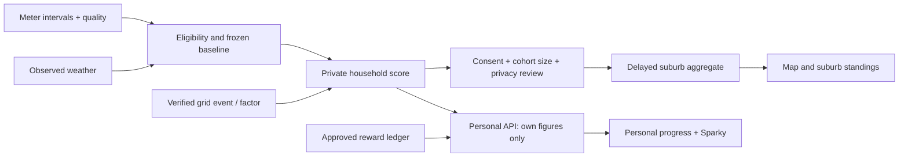

# Suburb Power Clash — implementation blueprint

**Status:** proposed design, 28 September 2026. This document defines an implementation path; Clash is not an existing Kea feature. The first deliverable is a **synthetic-data preview**. Real household competition, carbon savings, rewards, and public leaderboards remain disabled until the release gates below are met.

## What a player sees

An optional monthly, suburb-versus-suburb league helps a household reduce its own measured electricity use. The opening screen shows its own progress, an aggregated suburb standing, a stylized territory map, and Sparky's evidence-grounded coaching. A flash challenge appears only when the server has a verified, time-bounded event. The interface must always distinguish **demo**, **provisional**, **verified**, and **unavailable** figures.

The game compares a household with its **own** weather-adjusted history. Existing peer benchmarks remain separate: they cannot be substituted for a personal baseline. A lower bill is also not a direct result of fewer kWh; tariff and fixed charges matter.



### Reality checks before implementation

| Brief claim | Verified boundary and resulting product rule |
|---|---|
| Neighbour comparisons consistently save 2–4% | Published Opower experiments found roughly 1.4–2.8% at early sites; Kea has no measured effect yet. Treat behaviour change as a hypothesis and test it with an opt-in holdout, not a promised result. [NBER](https://www.nber.org/papers/w18492) |
| A low user will inevitably rebound unless given streaks and money | The original experiment found a boomerang effect and that approving feedback mitigated it. It does not validate these particular rewards. Give low users positive feedback without encouraging additional use. [Schultz et al.](https://doi.org/10.1111/j.1467-9280.2007.01917.x) |
| NZ is 80–85% renewable; peak savings routinely avoid coal at 650 g/kWh | MBIE reports 88.5% renewable generation for 2025. Marginal generation varies; no fixed peak window or 650/50 g pair is justified. No UI claim that a saved kWh avoided a specified amount of carbon until a reviewed marginal-emissions method exists. [MBIE](https://www.mbie.govt.nz/building-and-energy/energy-and-natural-resources/energy-statistics-and-modelling/energy-publications-and-technical-papers/energy-in-new-zealand/energy-in-new-zealand-2026/renewables), [Electricity Authority](https://www.ea.govt.nz/news/eye-on-electricity/marginal-generators-and-prices-in-the-electricity-market/) |
| Transpower intensity can calculate avoided emissions | Transpower EM6 reports average grid-mix intensity, useful as labelled context; it is not by itself a marginal avoided-emissions factor. Do not call savings an “offset”. [Transpower](https://www.transpower.co.nz/news/new-transpower-tool-unlocks-electricity-emissions-tracking-all) |
| A pseudonym and map bin ensure privacy | A small cohort and repeated ranks can still reveal a household. Require consent, delayed aggregation, a minimum cohort, suppression, and a Privacy Impact Assessment (PIA). [Privacy Commissioner: disclosure](https://www.privacy.org.nz/privacy-principles/11/), [PIA guidance](https://www.privacy.org.nz/responsibilities/privacy-impact-assessments/) |
| $50/$30/$15 bill credits, Free Power Sunday, hardware redemptions | These are **ideas**, not a funded or approved offer. Keep every value `null` and show no countdown to a payout until sponsor, retailer, legal, tax, terms, fulfilment, and relevant sales-promotion review are complete. [DIA guidance](https://www.dia.govt.nz/Gambling-Fact-Sheet-9---Sales-Promotions) |

## Release gates and ownership

| Gate | Acceptance evidence | Owner before real-data release |
|---|---|---|
| Identity and household authority | Replace synthetic demo login in `services/api/app/auth.py` with production auth, expiring sessions, server-side household binding and authorization tests. Never accept a client-selected household ID for `/me`. | API/security |
| Meter provenance | Every rewarded half-hour has a dated, measured import reading, source, completeness flag, and meter ownership. Reject estimates, generated demo profiles, missing intervals, and unverified solar/export or EV adjustments. | Data |
| Geography and consent | Approved suburb assignment separate from public responses; explicit opt-in, withdrawal, erasure/retention rules, minimum cohort and PIA. Current `Customer.region` is too broad and has no verified suburb. | Privacy/product |
| Fairness and safety | Independent review of baseline, cold-weather hardship, occupancy/holiday edge cases, solar and EV treatment, score manipulation, and appeal route. Low usage is a review signal, never evidence of a holiday. | Product/data |
| Carbon and live events | Documented marginal methodology and licensed time-stamped data for avoided-emissions claims; signed/verified event source and audited start/end for flash challenges. Until then, both features are unavailable. | Energy/data |
| Rewards | Written funding, eligibility, retailer settlement, legal terms and financial audit. Reward ledger reconciles exactly; no client calculation determines money. | Business/legal |
| Device performance | 60 fps target measured on representative iOS and Android devices, including a low-end device, with reduced-motion and static-list fallback. No performance claim based on simulator or export alone. | Mobile/QA |

## Scoring contract

These parameters are **proposed initial tuning**, not empirically proven weights. Store the score algorithm version and parameters with each monthly baseline snapshot; never silently recalculate published results under a new version.

1. **Input:** a half-hourly import interval `E(h,t)` in kWh, source `measured`, timezone-aware timestamp, account/meter ownership, local `Pacific/Auckland` date, and `expected_intervals` for that local day (46/48/50 across daylight-saving changes). Deduplicate by meter and interval. No data from the contest month may train its baseline.
2. **Freeze baseline at month start:** from the preceding 21 complete local days, take the median for each local wall-clock half-hour slot separately for weekdays and weekends. Require at least 12 weekday and 4 weekend observed examples for every normal slot. On a fall-back day, both occurrences of a repeated clock slot use that slot's frozen median; distinguish their readings by UTC offset. On a spring-forward day, skipped slots contribute neither baseline nor reading. Use the recorded `expected_intervals` to check the actual day; do not duplicate or invent readings. A household without enough history is `unqualified`; it never receives a guessed score.
3. **Weather:** using at least 56 prior complete days from the same location and weather source, fit a reviewed, nonnegative daily temperature response `f(T) = max(0.1, α + βh·max(15−T,0) + βc·max(T−22,0))` with `βh, βc ≥ 0`. Record model version and fit diagnostics. For contest day `d`, `B(h,t) = max(0, median_slot(h,t) × clamp(f(Td)/f(Tref), 0.75, 1.25))`, where `Tref` is the median temperature of the baseline days with that day type. A weather observation can settle a provisional score after the day closes, but the fitted coefficients and slot medians remain frozen. A failed fit or missing temperature makes the score unavailable, not zero.
4. **Quality:** a day qualifies for prize ranking only when every expected interval has a measured, nonnegative value and no disputed meter changes. An incomplete day can show a personal progress preview labelled `provisional`, but contributes nothing to the ranked month. Solar/export households require separately verified import, export, and on-site generation treatment; until then they remain preview-only. Safety review also covers heating hardship before any incentive to consume less.
5. **Peak-weighted reduction:** `D(t) = B(t) − E(t)`; `w(t) = 3.5` only for a versioned, verified grid-event window, otherwise `1`. `Penergy = Σ[w(t)·D(t)] / Σ[w(t)·B(t)]`. The separate display field `energy_reduction_pct = 100 × ΣD(t)/ΣB(t)` is **unweighted** over qualified intervals. Include negative `D` so rebound is visible. If a denominator is zero, mark unqualified. “Peak” is not a permanent clock-time label or a proxy for coal.
6. **Carbon term, only after gate:** with an approved *marginal* factor `c(t)` for every included interval, `Pcarbon = Σ[c(t)·D(t)] / Σ[c(t)·B(t)]`; factors must be nonnegative and denominators positive. `score = 100 × (0.7·Penergy + 0.3·Pcarbon)`; sort by unrounded decimal score, then stable participant ID. Until approval, return `score: null`, `carbon_avoided_kg: null`, and `energy_reduction_pct` as a clearly labelled preview. Never replace the missing carbon term with zero and call the mixed score final.
7. **Monthly settlement:** aggregate only qualified days; require at least 80% of the month's expected intervals and at least 14 eligible local days, with no unresolved anomaly. The status stays `provisional` until source data and quality review close. The 0.15 kWh/day threshold is a configurable **anomaly flag** for human/self-service review; it never infers occupancy or automatically declares vacation. Exclude a flagged day from prizes until resolved, without publishing the flag.

All score inputs, revisions, consent, and decisions need an audit record. Use decimal arithmetic for energy and money, UTC in storage plus the NZ local date in settlement logic. A negative score stays negative; never turn increased usage into a positive badge. Show a source and quality label beside each figure.

## Mobile screen and interaction contract

The proposed route is `services/mobile/src/app/(tabs)/clash.tsx`, registered in `(tabs)/_layout.tsx` behind an explicit server-controlled demo feature flag. Use the current dark theme from `src/theme/index.tsx`; the brief's forest-green replacement palette is not the app's design system. Reuse existing semantic accents and the Home flow green where it actually represents energy. Do not create a separate brand or imitate exact household locations.

| Component | Inputs and behaviour | Empty / error / accessibility |
|---|---|---|
| `SuburbLeagueHeader` | `league: LeagueSummary`, `personal: PersonalMetrics`; month in NZ time, current aggregate standing, personal status. Reward countdown only when approved funded reward is active. | Demo/unavailable/provisional labels; absolute end time as text; no colour-only rank. |
| `GamifiedTerritoryMap` | `districts: DistrictAggregate[]`, `selected_id`, `on_select`; static authored SVG paths for suburb-shaped **illustrations**, never geocoded homes. Pan/pinch through Gesture Handler and Reanimated shared values on UI thread; bounded scale 1–2.5, pan clamped to viewBox. | List of the same districts immediately below as a keyboard/screen-reader alternative; no participant pins or live occupancy pulse. Reduced motion yields static paths. |
| `SuburbLeaderboard` | delayed suburb aggregate ranks and optional consented pseudonymous individual ranks from server; stable rank and tie rules. | Hide individual list unless PIA and `cohort_size ≥ 20`; suppress small cells and differencing across filters/time; no raw traces. |
| `SparkyCompanionWidget` | status from explicit `unqualified / preview / improving / steady / review`, one short tip grounded in verified own data. | No “power vampire”, appliance diagnosis, carbon claim, or shame based on whole-home data. Static state and accessible text when animations off. |
| `FlashChallengeBanner` | server-signed challenge ID, source, local start/end, expected action and opt-in state. | Absent when event source is unavailable; no fabricated “500 points” or assumed washer/dryer ownership. |

Keep SVG node/path counts bounded (initial target ≤12 districts and ≤24 decorative paths). Animate transforms and opacity via shared values, avoid per-frame React state or layout work, pause animations on blur/background, and respect OS reduced motion. Show a confirmation after opt-in, withdrawal, challenge settlement, and any later model/score revision; confirmations state source, time, and whether a result is provisional. Haptics are optional and must follow system preferences. The static map/list must remain usable when animation fails.

## API and data model

The repository uses **FastAPI + Pydantic**, not Node/Fastify. `docs/api-standards.md` requires `/api` without a `/v1` path, plural collection nouns, `snake_case` JSON, and generated OpenAPI. The requested endpoints map as follows:

| Prompt path | Repository-conformant path | Access |
|---|---|---|
| `GET /api/v1/clash/suburb/{suburb_id}` | `GET /api/clash/suburbs/{suburb_id}` | Only delayed, privacy-safe suburb aggregates. |
| `GET /api/v1/clash/household/metrics` | `GET /api/clash/me/metrics` | Server-bound authenticated household only. |
| `POST /api/v1/clash/challenges/{challenge_id}/opt-in` | `POST /api/clash/challenges/{challenge_id}/participations` | Creates one opt-in for current household; idempotency key. |
| Additional consent action | `POST /api/clash/participations` and `DELETE /api/clash/participations/me` | Explicit join and withdrawal; withdrawal revokes future disclosure/rewards per terms. |

Implement Pydantic response models first and generate `contracts/openapi.json` with `make api-spec`; `npm --prefix services/mobile run types` generates `src/api.d.ts`. Do not hand-edit either generated file. Extend API standards via an ADR for auth-related `401/403` and conflict `409` before introducing those statuses; retain FastAPI's current `{"detail": ...}` error envelope until a separate breaking-change ADR.

Illustrative **response semantics** (Pydantic is the source of truth):

```ts
type EvidenceState = 'demo' | 'provisional' | 'verified' | 'unavailable';
type PersonalMetrics = {
  month: string; // YYYY-MM in Pacific/Auckland
  status: EvidenceState;
  qualified_days: number;
  expected_days: number;
  energy_reduction_pct: number | null;
  score: number | null;
  carbon_avoided_kg: number | null;
  rank: number | null;
  reward_credit_nzd: string | null; // decimal string; null until approved and earned
  feathers_balance: number | null; // null until a funded, governed ledger exists
  source_as_of: string | null; // ISO-8601 with offset
  score_version: string | null;
  quality_reason: string | null;
};
type DistrictAggregate = {
  suburb_id: string; label: string; month: string;
  status: EvidenceState; rank: number | null;
  participant_count_band: string | null; // broad band, not precise live occupancy
  aggregate_reduction_pct: number | null;
  carbon_avoided_kg: number | null;
  published_at: string | null;
};
type LeagueSummary = {
  month: string; ends_at: string; status: EvidenceState;
  districts: DistrictAggregate[];
  reward: { status: 'unavailable' | 'approved'; terms_url: string | null };
};
type Challenge = {
  id: string; status: 'scheduled' | 'active' | 'closed' | 'cancelled';
  source: string; starts_at: string; ends_at: string;
  opt_in_status: 'not_joined' | 'joined' | 'settled' | 'ineligible';
  points: number | null;
};
```

Use `200` for reads, `201` plus `Location` for a new participation, `204` for withdrawal, `404` for unknown resources, `422` for validation, `503` for a required upstream dependency. Auth and duplicate-join handling follow the ADR. Do not return raw meter traces, customer IDs, precise geo coordinates, or participant presence from public aggregate endpoints. Cache aggregates by version and publish with a delay of at least 24 hours; suppress every cohort below 20 and any combination of filters that could reconstruct a small cell. The PIA decides whether 20 and 24 hours are sufficient.

Proposed PostgreSQL `app` tables (new Alembic revision after current head): `clash_participation` (account binding, consent version/time, withdrawal), `clash_baseline_snapshot` (immutable month, algorithm/version, weather model, quality), `clash_score` (daily inputs and audit/version), `clash_challenge` plus `clash_challenge_participation` (signed source, state, idempotency), `clash_privacy_aggregate` (cohort, suppression, published time), and a separate `clash_reward_ledger` **only after** reward approval. Keep suburb mapping private and avoid address/ICP in response models or public aggregate tables. Define retention and deletion before real data is ingested.

## File-by-file implementation order

1. **Discovery and decisions:** review `services/api/app/auth.py`, `services/api/app/db/models.py`, `services/api/app/main.py`, `services/mobile/src/providers/auth.tsx`, existing Home and theme components, API standards, and existing security policy. Record production-auth, consent, geography, score, carbon, and reward decisions. No actual customer data in this phase.
2. **Demo contract:** add Pydantic models and a fixture-only router at `services/api/app/clash/schemas.py` and `services/api/app/clash/routes.py`; register at `services/api/app/main.py` under `/api`. Add deterministic synthetic Grey Lynn, Ponsonby, and Mount Eden **district aggregates** in `services/api/app/clash/fixtures.py`, clearly marked `demo`; use `null` for carbon, score, money, and feathers. Never seed a real address. Add API tests for responses and prohibited fields.
3. **Contract generation:** run `make api-spec`, then `npm --prefix services/mobile run types`; commit generated `contracts/openapi.json` and `services/mobile/src/api.d.ts` together. Add API standards examples only after capturing them from the running API.
4. **Mobile data layer:** add `services/mobile/src/features/clash/api.ts` and `types.ts` that consume generated types, parse evidence state, and handle loading/offline/error. Feature flag defaults off. No persisted public leaderboard cache beyond the approved retention window.
5. **Mobile UI:** create `services/mobile/src/app/(tabs)/clash.tsx` and components `SuburbLeagueHeader.tsx`, `GamifiedTerritoryMap.tsx`, `SuburbLeaderboard.tsx`, `SparkyCompanionWidget.tsx`, `FlashChallengeBanner.tsx` under `services/mobile/src/features/clash/components/`; add the tab only with its flag. Reuse existing tokens and Sparky art; provide static list/reduced-motion path.
6. **Math behind gates:** add `services/api/app/clash/baseline.py`, `scoring.py`, `eligibility.py`, and fixtures/tests for normal, cold snap, solar/export, missing interval, DST, 0.15 kWh anomaly, rebound, and withdrawal. Add migrations only when model and privacy decisions are approved. Demo scoring cannot unlock rewards.
7. **Release features separately:** verified auth and consent → qualified data and geography → privacy-reviewed aggregate → validated grid events and carbon method → funded reward ledger. Each has an independent flag and rollback route. Do not turn all on with one switch.

### Verification and definition of done

From the repository root, with the API virtual environment and mobile dependencies already installed outside the Vault (the API Makefile accepts a `VENV` override):

```bash
api_venv="$HOME/.cache/vault-builds/kea-agent/api-venv"
make -C services/api VENV="$api_venv" check
make -C services/api VENV="$api_venv" spec
npm --prefix services/mobile run types
npm --prefix services/mobile run typecheck
npm --prefix services/mobile run lint
npm --prefix services/mobile run test
git diff --check
```

The demo is complete only when API tests prove no raw/identifying fields escape, missing evidence renders `unavailable`, generated contracts match the API, and iOS/Android static and animated states are visually inspected. A physical-device trace is needed before describing motion as 60 fps. Production is complete only after every release gate has an owner and recorded acceptance evidence; until then all money, carbon, and public individual rankings remain disabled.
