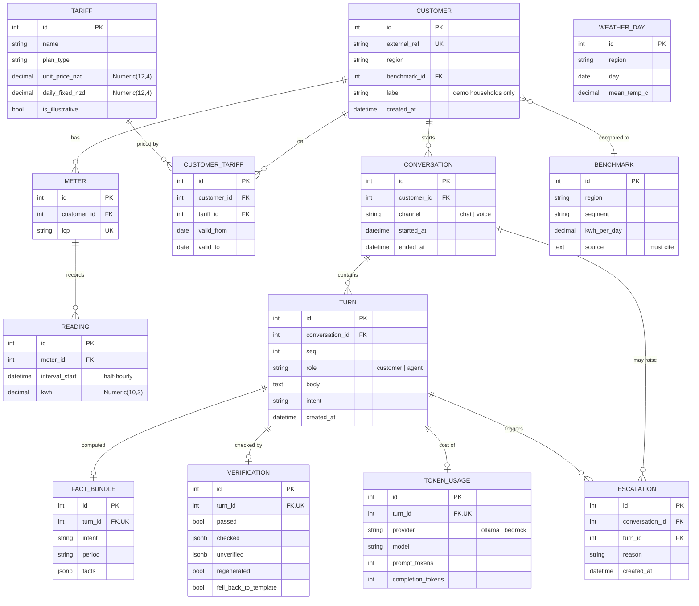

# Data model (ERD)

PostgreSQL from Sprint 2 ([ADR-0006](adr/0006-postgres-in-sprint-2.md)).
Source of truth is `app/db/models.py`; this diagram is generated from it by hand
and must be updated in the same PR as any schema change.

Build it with `alembic upgrade head`.

---

## Diagram

---

## Why the tables are shaped this way

**Three groups.** Reference data (`benchmark`, `tariff`, `weather_day`), customer
data (`customer`, `meter`, `reading`, `customer_tariff`), and the evidence trail
(`conversation`, `turn`, `fact_bundle`, `verification`, `token_usage`, `escalation`).

| Choice | Reason |
|---|---|
| `Numeric`, never `float`, for kWh and money | binary floats cannot represent `0.1`. A pitch about not fabricating numbers cannot round badly |
| `reading` is half-hourly, indexed on `(meter_id, interval_start)` | 5 households × 31 days × 48 = ~7,440 rows for the demo alone; this is time-series access |
| `fact_bundle.facts` is `JSONB` | facts differ per intent; a rigid column set would need a migration per new analytic |
| `verification` is its own table, 1:1 with `turn` | it is the evidence for *"0 fabricated figures"*. Evidence you compute later is not evidence |
| `token_usage` is its own table, 1:1 with `turn` | the Bedrock cost projection multiplies these by published rates. Cannot be reconstructed retroactively |
| `benchmark.source` is `NOT NULL` text | every external figure carries a source link. Enforced in the schema, not by memory |
| `tariff.is_illustrative` defaults `true` | prevents an illustrative price being quoted as if it were a real Kea Energy rate |
| `customer.external_ref`, not a name | no PII in the model. See [`SECURITY.md`](../SECURITY.md) |

## Changing the schema

1. Edit `app/db/models.py`.
2. `alembic revision --autogenerate -m "..."` — then **read the generated migration**. Autogenerate misses renames and constraint changes.
3. Update this diagram in the same PR.
4. `alembic upgrade head` on an empty database must still build the whole schema.
5. Migrations touching `alembic/` or `app/db/` require maintainer review (CODEOWNERS).

---

## Related

- [`prd.md`](prd.md) · [`api-standards.md`](api-standards.md) · [ADR-0006](adr/0006-postgres-in-sprint-2.md)
