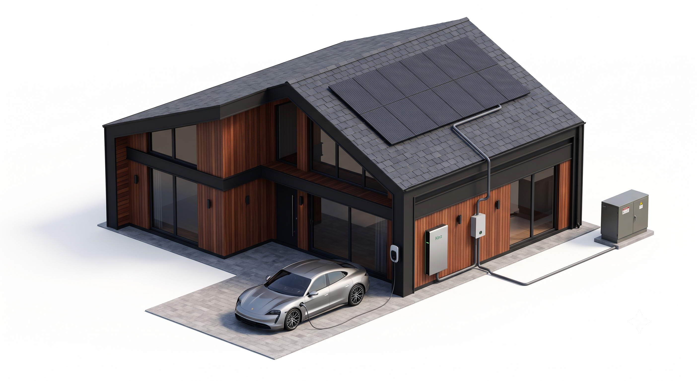
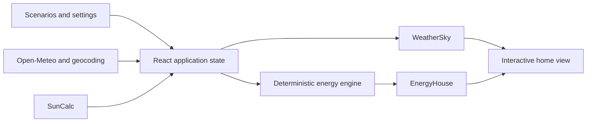

# Kea Energy Home

> A cinematic, interactive home-energy prototype with live weather, astronomical positioning, deterministic energy dispatch, and animated power-flow visualization.

[](https://react.dev/)
[](https://www.typescriptlang.org/)
[](LICENSE)



Kea Energy Home is a standalone React prototype for exploring how solar generation, household demand, EV charging, battery storage, and the electricity grid interact. Live weather comes from Open-Meteo; the energy values are deliberately simulated and are never presented as connected meter or inverter telemetry.

## Highlights

- Live weather, town search, and location-aware sky rendering.
- Sun and Moon placement calculated with SunCalc and a configurable house bearing.
- Balanced energy dispatch with battery reserve, grid outage, curtailment, and load-shedding states.
- GSAP-powered, direction-aware flow particles with source semantics:
  - solar: green
  - battery discharge: blue
  - grid import: orange
- Responsive settings and scenario controls for Sunshine, Cloudy, Rain, Moonlight, and Starry Night.
- Strict TypeScript, deterministic tests, and dependency-audited production builds.

## Quick start

Requirements: Node.js 22.18 or newer and npm 10 or newer.

```bash
cd services/web/energy-home-prototype
npm run dev
```

Open [http://localhost:5188](http://localhost:5188).

## Verification

```bash
npm run check
```

The check command runs strict type checking, all unit and scenario tests, and a production build. You can also run each stage independently:

```bash
npm run typecheck
npm test
npm run build
npm run preview
```

## System boundary

| Capability      | Source                                      | Boundary                                      |
| --------------- | ------------------------------------------- | --------------------------------------------- |
| Current weather | Open-Meteo                                  | Live model data; network access required      |
| Location search | Open-Meteo geocoding / GeoNames attribution | Search results only                           |
| Sun and Moon    | SunCalc                                     | Calculated locally from coordinates and time  |
| Energy readings | Local dispatch engine                       | Demonstration values, not household telemetry |
| Preferences     | Browser `localStorage`                      | Stays in the current browser                  |

No account, backend, analytics service, advertising SDK, or persistent server database is used. See [Data and privacy](docs/DATA_AND_PRIVACY.md) for the complete data-flow description.

## Architecture



The detailed component model, invariants, and trade-offs are documented in [Architecture](docs/ARCHITECTURE.md).

## Repository map

```text
.
├── .github/             CI and issue templates
├── design-assets/       Source renders and design specification
├── docs/                Architecture, privacy, deployment, and provenance
├── public/              Runtime fonts, image, and favicon
├── src/components/      Interactive visual components
├── src/lib/             Weather, astronomy, preferences, and energy logic
├── tests/               Node test-runner suites and scenario invariants
└── package.json         Commands and dependency manifest
```

## Documentation

- [Architecture](docs/ARCHITECTURE.md)
- [Data and privacy](docs/DATA_AND_PRIVACY.md)
- [Deployment](docs/DEPLOYMENT.md)
- [Asset provenance](docs/ASSET_PROVENANCE.md)
- [Contributing](CONTRIBUTING.md)
- [Security policy](SECURITY.md)
- [Third-party notices](THIRD_PARTY_NOTICES.md)
- [Changelog](CHANGELOG.md)

## Limitations

- Energy values are simulated examples; no smart meter, battery, EV charger, or inverter is connected.
- Solar output does not model roof pitch, shading, inverter efficiency, panel degradation, or a real installed capacity.
- Preset weather scenarios are visual demonstrations rather than forecasts for their preview time.
- Commercial or high-volume weather use should be reviewed against the provider's current service terms.

## License

Project code and assets are released under the [MIT License](LICENSE). Third-party components remain under their respective licenses; see [Third-party notices](THIRD_PARTY_NOTICES.md).
