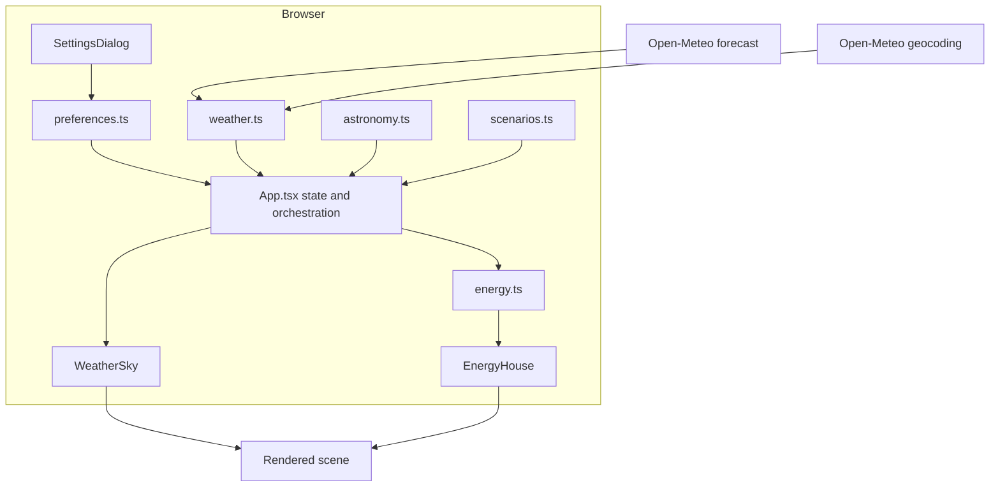

# Architecture

## Goals

Kea Energy Home makes a complex home-energy state understandable at a glance while keeping live model data, local calculations, and demonstration values clearly separated.

## Component map

## Responsibilities

| Module                   | Responsibility                                                                          |
| ------------------------ | --------------------------------------------------------------------------------------- |
| `src/App.tsx`            | Owns selected scenario, current settings, weather state, and derived presentation state |
| `src/lib/weather.ts`     | Fetches, validates, maps, and attributes weather and geocoding responses                |
| `src/lib/astronomy.ts`   | Calculates Sun/Moon state and camera-relative visibility                                |
| `src/lib/energy.ts`      | Performs deterministic power dispatch and enforces storage limits                       |
| `src/lib/scenarios.ts`   | Produces stable visual preview conditions                                               |
| `src/lib/preferences.ts` | Reads and writes browser-local settings safely                                          |
| `WeatherSky`             | Renders time-of-day, clouds, precipitation, fog, stars, Sun, and Moon                   |
| `EnergyHouse`            | Renders the architectural asset, device values, routes, and directional flow particles  |
| `SettingsDialog`         | Provides location, orientation, time-zone, and display settings                         |

## Energy dispatch order

Solar power is assigned in this order:

1. household demand;
2. EV charging when enabled;
3. battery charging within power and capacity limits;
4. grid export.

When generation is insufficient, the battery supplies the deficit only above its reserve and within its discharge limit. The grid supplies the remaining deficit. During an outage, home load is protected before optional EV demand; unmet demand and solar curtailment remain explicit.

## Invariants

- Input power values are finite and non-negative.
- Battery state stays between reserve and capacity.
- Energy is conserved across generation, storage, load, export, import, curtailment, and unserved demand.
- Network failure never silently becomes synthetic live weather.
- Source color follows the actual origin of power, not merely the destination route.
- Without a calibrated house bearing, directional celestial discs are hidden rather than guessed.

## Runtime model

The project is a static single-page application. There is no server runtime after build; `dist/` can be served by any static host. Browser requests to external weather services require network access and are subject to provider availability and terms.

## Trade-offs

- A static architecture is easy to run and inspect but cannot safely hold provider secrets.
- The fixed architectural render creates a strong visual identity but makes conduit geometry asset-specific.
- Deterministic example readings make behavior testable but must never be confused with telemetry.
